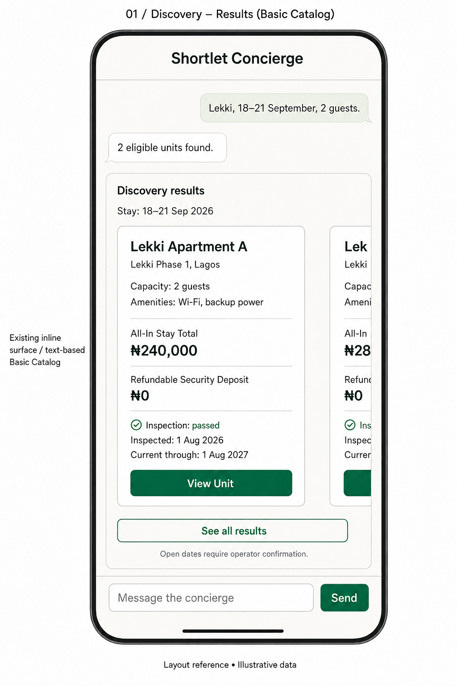
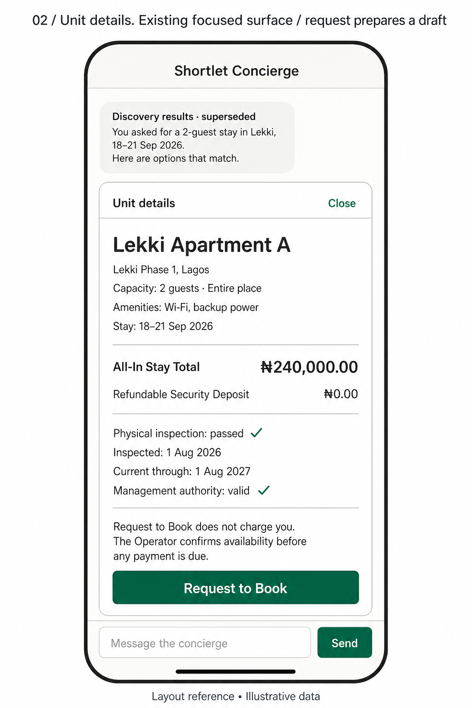
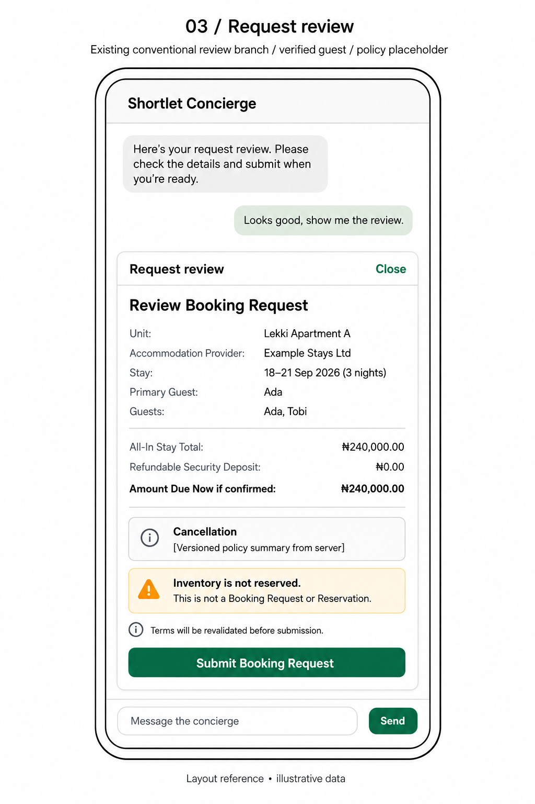
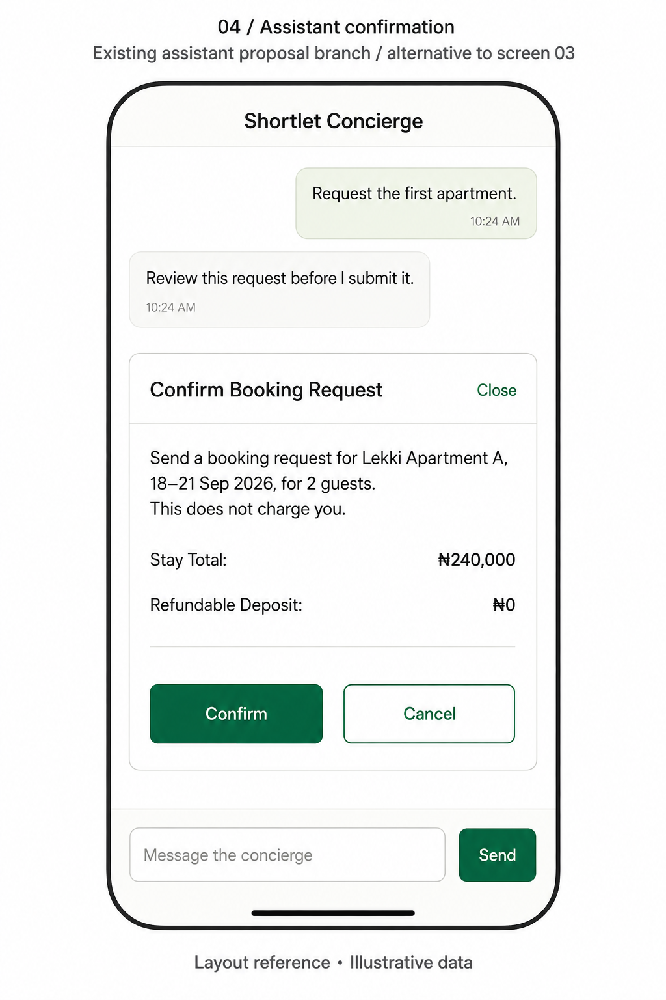
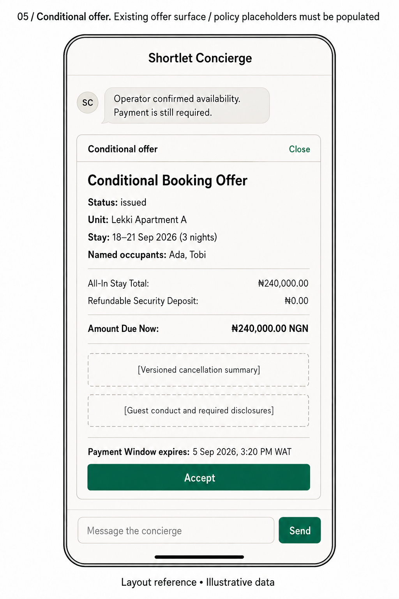
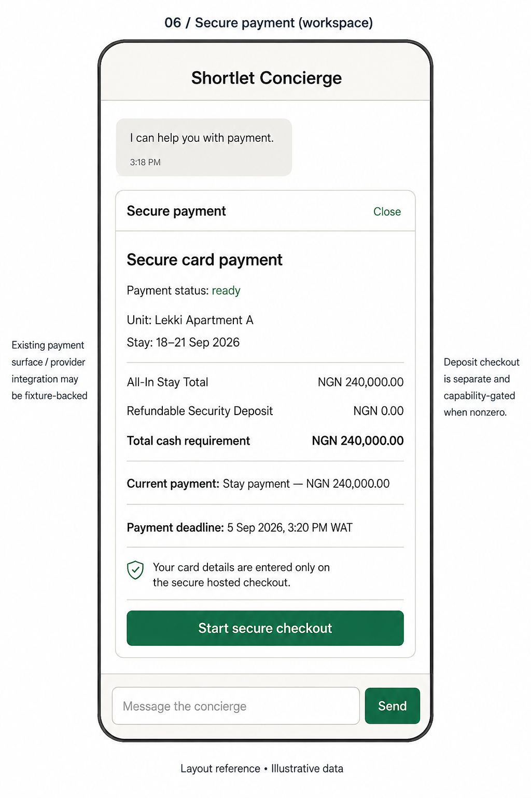
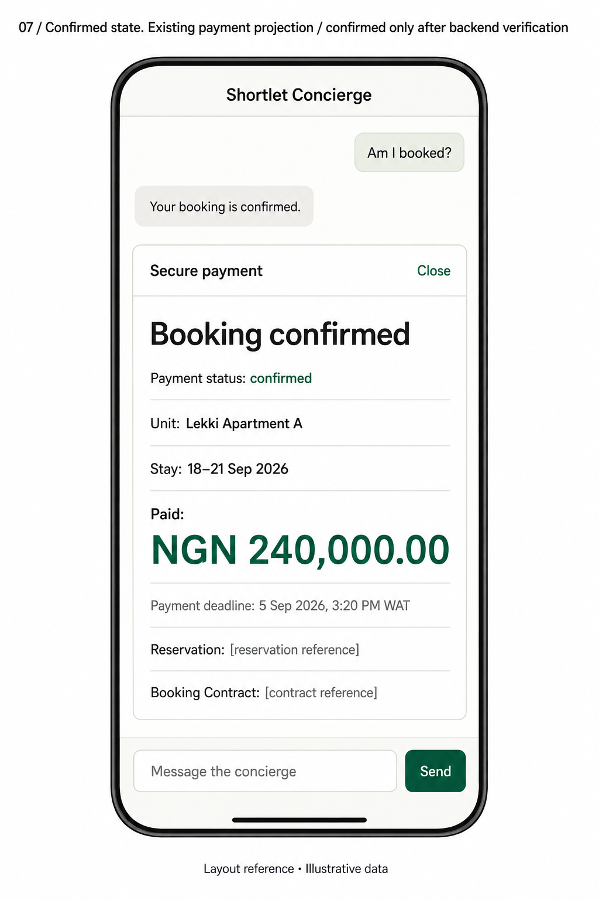
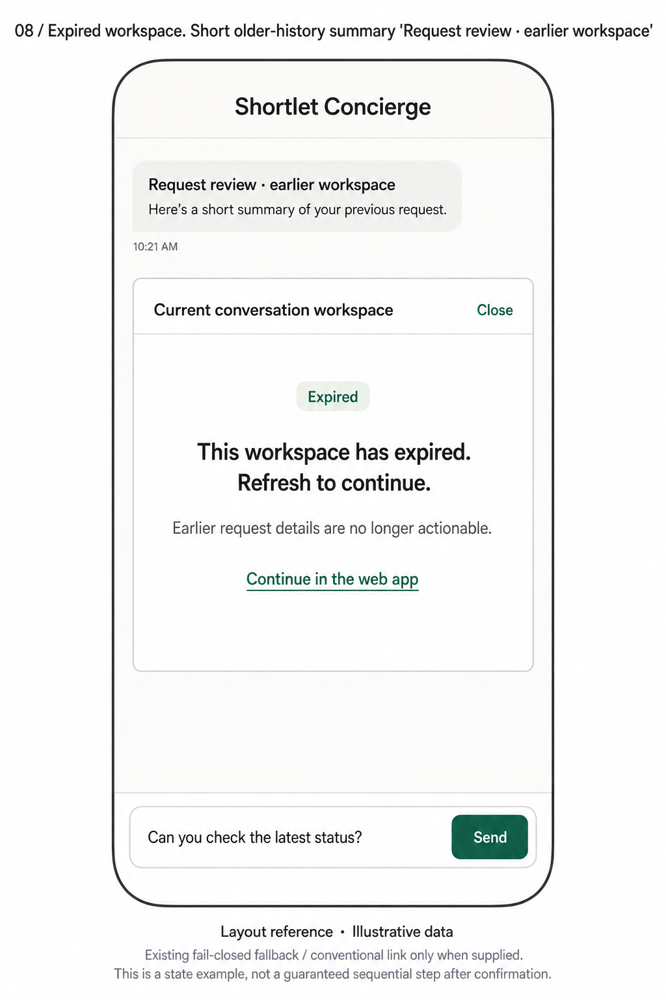

# Shortlet Concierge mobile wireframes

Eight separate 1024 × 1536 PNG references, generated on 5 September 2026 using the built-in image generation tool. These are layout references grounded in the current working-tree implementation, not screenshots or evidence of production capability certification. Application code was not changed.

## Scope and fidelity

The images retain the existing conversation, one active Weaver workspace, text-based Basic Catalog surfaces, and sticky composer. Focused workspaces remain inside the conversation shell. The earlier recommendation for full-screen routes and permanent Discover/My stays/Help navigation is not represented as an existing feature.

Spacing, grouping, amount formatting, illustrative conversation copy and minor decorative marks are design suggestions rather than exact copies of current HTML. Images are not pixel specifications: content may scroll on real phones and must retain the application's accessibility and disclosure requirements. Small avatars or message timestamps in generated drawings do not establish messaging capabilities. No photos, maps, favourites, voice controls, saved cards or instant-booking controls are introduced.

Names, dates, inspection claims and prices are illustrative. The zero-deposit example does not remove deposit support: nonzero deposits remain separately disclosed, separately collected where the current payment journey requires it, and capability-gated. Policy and reference placeholders are deliberately visible; they are not deployable policy copy. Existing server-produced facts, actions and disclosures remain authoritative.

## Screen index

| Image | Existing source | Meaning |
| --- | --- | --- |
| [01 Discovery](01-discovery.png) | [discovery-a2ui.ts](../../../apps/web-agent/src/discovery-a2ui.ts) | Horizontal text-based unit results, View Unit and See all results. No Close on inline discovery. |
| [02 Unit details](02-unit-details.png) | [unit-detail-a2ui.ts](../../../apps/web-agent/src/unit-detail-a2ui.ts) | Dates, all-in pricing, separate deposit and specific trust facts. Request to Book prepares the local draft flow. |
| [03 Request review](03-request-review.png) | [request-draft-a2ui.ts](../../../apps/web-agent/src/request-draft-a2ui.ts) | Reviewed draft for an eligible verified guest, with Submit Booking Request. A preceding draft has Review Request; blocked drafts do not have this submission action. |
| [04 Assistant confirmation](04-assistant-confirmation.png) | [pending-action-a2ui.ts](../../../apps/local-guest/src/assistant/pending-action-a2ui.ts) | Alternative assistant proposal branch with Confirm/Cancel. It is not an extra mandatory screen after 03. |
| [05 Conditional offer](05-conditional-offer.png) | [conditional-offer-a2ui.ts](../../../apps/web-agent/src/conditional-offer-a2ui.ts) | Operator has confirmed availability; offer status is issued. Accept is present only when authorized. Payment is still required. |
| [06 Secure payment](06-secure-payment.png) | [card-payment-a2ui.ts](../../../apps/web-agent/src/card-payment-a2ui.ts) | Ready state with Start secure checkout. Credentials belong to the provider-hosted surface. |
| [07 Booking confirmed](07-booking-confirmed.png) | [card-payment-a2ui.ts](../../../apps/web-agent/src/card-payment-a2ui.ts) | Backend-confirmed state, paid amount and references. The existing adapter retains the payment-deadline field even in this state. |
| [08 Expired workspace](08-expired-workspace.png) | [conversational-shell.ts](../../../apps/local-guest/src/conversational-shell.ts), [client.ts](../../../apps/local-guest/src/client.ts) | Non-actionable recovery example; conventional link exists only when supplied by the application. Composer draft remains available. |

## Journey relationships

Main conventional route: discovery → unit detail → request draft → request review (03) → submitted request / operator wait → conditional offer (05) → accepted contract / payment preparation → secure payment (06) → provider checkout → return verification → confirmed state (07), only when backend conditions pass.

Assistant route: search/detail tools → pending request proposal (04) → explicit confirmation → platform result. Offer acceptance and starting checkout also have their own proposal confirmations when initiated conversationally.

Screen 08 is a lifecycle branch that can arise while interacting with an old surface. It is not a required step after confirmation and surface expiry does not cancel a committed reservation.

This is a selected set of key screens, not an exhaustive state chart. The current payment adapter additionally represents checkout_initiated and deposit_required, exposes “I have returned from secure checkout” when verification is allowed, and exposes “Continue to refundable deposit” when required. Merely opening or returning from checkout is not confirmation. Waiting, failed and reconciliation states must not be visually collapsed into success. The local demo can use fixture-backed identity/operator/provider capabilities; these drawings do not certify production integrations.

## Governing design constraints

- ADR-0005: Request to Book; operator confirmation and verified payment are distinct.
- ADR-0011, 0013: guest verification and payer requirements remain in effect.
- ADR-0015, 0016: all-in stay total and refundable deposit retain separate meaning.
- ADR-0044–0046, 0049: authoritative payment windows, one live attempt, late-payment handling and hosted checkout.
- ADR-0072, 0074: explicit consequential commands and non-actionable stale/expired surfaces.
- ADR-0078: accessible Nigerian launch presentation; en-NG, NGN and WAT.
- ADR-0080, 0081: conventional parity, approved Basic Catalog and Weaver behind application boundaries.

The written source contracts govern if a generated visual differs. Reviewed corrections removed the accidental discovery Close control, corrected the offer state to issued, and aligned the request-review background with the set.

Generation prompts and applied edit instructions are preserved in [prompts.json](prompts.json).

## Images

### 01 — Discovery

### 02 — Unit details

### 03 — Request review

### 04 — Assistant confirmation

### 05 — Conditional offer

### 06 — Secure payment

### 07 — Booking confirmed

### 08 — Expired workspace

