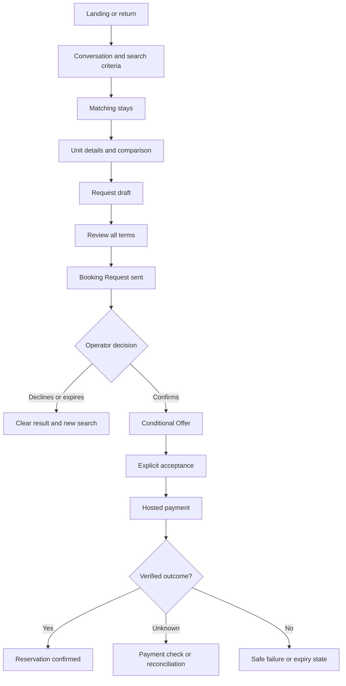

# Chat Marketplace: Product UI/UX Guidelines and Implementation Plan

**Status:** Adopted 10 November 2026 as the cross-cutting UX standard. Implementation is tracked in `.scratch/ux-guidelines/` (map and issues 01–31). Accepted ADRs and the Guest UI kit take precedence (§1, source precedence).  
**Prepared:** 10 November 2026  
**Repository:** `cyruslayo/chat-marketplace`  
**Inspected baseline:** `main` at `16edba6b7d5eb88819d3abb06f74804740dc11ab` (8 November 2026). This baseline is older than current `main`; Phase 0 (issues 01–05) re-checks it.  
**Primary design reference:** *Human Interface Design: A Working Field Handbook*, based on Apple's *Macintosh Human Interface Guidelines* (1992), Chapters 1, 3, 6, 7, and 11.

> **Product promise:** Help people find the right stay, understand its full cost, request it, pay safely, and know what happens next. Conversation may guide the journey. The active workspace must make each important decision clear.

## 1. Executive decision

This project needs **experience governance**, not a second visual system.

The repository already contains a shortlet design audit, design-system direction, landing-page direction, and an implemented Guest UI kit. It also has a confirmed design direction, component classes, and parity requirements. Replacing those pieces would add cost and cause divergence.

**Keep:** The approved warm-paper, green, and ink design language; the `ui-*` Guest kit; the mobile task-focused flow; the desktop conversation/workspace relationship; the Weaver Basic Catalog; and deterministic standard pages.

**Improve:** Clear task hierarchy, current-state comprehension, trusted money language, explicit recovery, focus/keyboard behavior, slow-network behavior, and actual user testing.

**Do not expand scope:** Shortlet is the active public product. Commerce remains parked behind `COMMERCE_ENABLED` under ADR-0104. A future commerce release should reuse the common rules but receive its own task and legal review.

### Evidence categories

- **Verified in the repository:** Source files, accepted ADRs, design documents, and the Guest UI consistency effort.
- **Previously observed:** Findings A1–A18 from `docs/design/shortlet-ui-ux-audit.md`. They describe an earlier inspected baseline. Do not assume every finding remains unresolved.
- **Read on staging:** The current guest entry offers city starters, an explicit demo notice, a conversation input, and a route back to an existing stay. This is a text/semantics inspection of the entry screen, not a new visual or full-journey audit.
- **Proposed:** The design gates, user-test protocol, prioritization, and metrics in this document.

**Source precedence for work:** Current accepted ADRs and domain projections → current approved Guest UI kit and design direction → current application behavior and verified test evidence → this guideline → historical wireframes and older audit findings. When these sources conflict, record the conflict. Never silently change business policy.

## 2. The experience constitution

The Apple handbook describes principles. This section turns them into contracts for the project. The modern implementation rules are our interpretation, not claims about the 1992 platform.

| Handbook principle | Product rule | Verification |
| --- | --- | --- |
| Metaphors | A Unit is an apartment listing; a Request is not a Reservation. | New users explain the difference without coaching. |
| Direct manipulation | Let users select, compare, and edit visible stay facts. | Date and party changes keep the selected context visible. |
| See-and-point | Offer visible city choices, result actions, and next steps. | No required booking action depends on memorizing a chat command. |
| Consistency | A familiar action uses one label, meaning, and visual role. | Chat and standard routes show the same command and facts. |
| WYSIWYG | Review shows the exact authoritative dates, terms, and money. | Submitted terms match reviewed projections unless a fresh review occurs. |
| User control | A model can propose. Only a validated command can act. | No material action fires without correct authority and consent. |
| Feedback | Show the state of each meaningful operation. | Pending, success, expired, error, and uncertainty remain distinguishable. |
| Forgiveness | Preserve the entered task and support safe recovery. | A failed submit never silently loses the draft or duplicates a command. |
| Stability | Keep task, focus, and reading position dependable. | A refreshed or replaced workspace preserves meaningful context. |
| Aesthetic integrity | Visual emphasis follows user importance. | Unit, total, deadline, and action dominate decorative content. |
| Modelessness | Do not block work without a required decision. | Harmless information uses inline content, not repeated dialogs. |
| Audience/access | Design for real Nigerian phones and networks. | Keyboard, 320px, assistive technology, and poor connection paths pass. |

**Five-step review loop:** Identify the person and task. Remove choices. Select controls. Define feedback and recovery. Observe a real user.

## 3. Audience and the jobs to be done

### Guest: first-time explorer

**Question:** “Can I find a real apartment in my city and understand what it will cost?”

A Guest needs a clear entry point, search help, listing comparisons, photos, honest trust claims, and readable prices. Do not require the Guest to learn prompt syntax or platform terminology.

### Guest: ready to request

**Question:** “Am I booking this place now, or only asking the Operator?”

A Guest needs the selected Unit, dates, people, all-in price, relevant obligations, and one explicit next action. The interface must explain which step creates a Request, an Offer, a Payment, or a Reservation.

### Guest: returning or paying

**Question:** “What is my current status, and what do I need to do?”

A Guest needs a persistent current-stay summary, absolute deadlines, payment state, and a safe recovery route. The last chat message must not be the only source of truth.

### Operator: response and fulfillment

**Question:** “Which booking needs my response, by when, and what will my decision do?”

An Operator needs human-readable Unit and Guest context, a clear response deadline, and separate Confirm/Decline commands. Internal IDs remain secondary.

### Research contexts

Observe users with small Android phones, unstable connections, limited familiarity with booking systems, and different reading preferences. Include keyboard and screen-reader users. Do not confuse designer preference with task evidence.

## 4. Information architecture

### Active Shortlet experience

**Important:** The diagram shows conceptual stages, not permission to infer an unavailable command. Use the current domain state machine for exact transitions.

### Three persistent areas

1. **Conversation:** Explains intent, asks for missing details, and preserves relevant history.
2. **Current workspace:** Displays one authoritative stage, its facts, and the next allowed action.
3. **Task navigation:** Shows context, return paths, and progress without inventing status.

On mobile, the focused workspace occupies one view and one scroll area. Preserve a way back to the conversation. On desktop, show conversation and workspace together when useful. Do not create a second competing booking state.

### Progressive disclosure

Show the essential facts first. Put details and explanations behind clearly named sections when they are optional. Never hide material cancellation terms, payment obligations, or due amounts at acceptance.

- **Search:** Location, dates, guests, and results.
- **Result:** Unit, area, relevant capacity, all-in total, and “View Unit”.
- **Detail:** Images, amenities, exact stay facts, cost, applicable trust claims, and “Request to Book”.
- **Review:** Every material contractual fact before “Submit Booking Request”.
- **Confirmation:** Outcome, reservation reference, paid amount, dates, and next steps.

## 5. Screen contracts

Each screen must specify: person, object, trigger, primary action, authority, normal result, loading, failure, retry, and accessible focus.

| Surface | Visible hierarchy | Primary action | Essential recovery |
| --- | --- | --- | --- |
| Landing | Stay service, Abuja/Lagos, message entry, credible demo/live status | Start a stay search | Keep the typed first message |
| Discovery | Criteria, result count, Unit summary, All-In Stay Total | View Unit | Edit search; zero-results suggestions |
| Unit detail | Images, facts, availability qualifier, total, deposit when applicable | Request to Book | Return to results without losing selection |
| Draft | Unit, stay dates, party, draft status, no reservation claim | Review request | Edit criteria; save/reopen if supported |
| Review | Provider/Unit, dates, party, cancellation, total, deposit and amount due | Submit Booking Request | Correct fields; revalidate expired quote |
| Request sent | Waiting for Operator, what is blocked, absolute WAT deadline | View current request | Status refresh; safe route after expiry |
| Offer | Confirmed availability, exact price and payment window | Accept offer | Explain expiry; return to current status |
| Payment choice | Exact current amount and supported payment methods | Select approved method | Never claim success on provider return |
| Payment pending | Amount/reference, latest verified status, absolute deadline | Check payment status, if available | Reconcile uncertain outcome without double payment |
| Reservation confirmed | Reservation ID, Unit, stay, amount paid, access/arrival next steps | View reservation | Support and authoritative current record |
| Expired/declined | Human explanation, effect on request, no actionable stale surface | Find another stay | Retain relevant search criteria |
| Operator inbox | Unit name, dates, response deadline, readable status | Open request | Session expiry; return to inbox |
| Operator detail | Unit, occupancy, terms, deadline and decision effect | Confirm or Decline, separately | Visible after-action state; prevent duplicate decision |

**Avoid:** A result card with four equal calls to action. A busy workspace with no single decision. A generic “Continue” label that hides money or consent.

## 6. The conversation and generated-UI contract

The interface must remain useful without the model. This is a product requirement, not a visual preference.

1. The server provides authoritative amounts, dates, state, and allowed actions.
2. The model proposes structured intent. It cannot invent trusted facts or actions.
3. Weaver renders approved A2UI content behind platform-owned boundaries.
4. The active workspace owns actionable state. Old surfaces become read-only.
5. Consequential commands pass through the existing validation, authorization, version, and idempotency gates.
6. Standard web routes preserve the same facts and command behavior.
7. An unavailable model must not prevent a Guest from checking an existing booking.
8. A refreshed Worker must recover action identities and correct current stage.
9. A failing rich-UI surface falls back to safe, complete text and an available standard route.
10. Review actual rendered control semantics. A2UI accessibility metadata alone does not prove access.

### Turn behavior

- **During search:** Show useful clarification choices and retain entered search criteria.
- **During model wait:** Say “Finding stays that match your search.” Keep existing facts visible.
- **During command wait:** Say “Sending your Booking Request.” Block repeated submission.
- **After a successful command:** Name the new authoritative state once.
- **After a rejected command:** Explain the cause only when known. Preserve the draft and show the correction.
- **After a stale action:** Remove its authority. Offer refresh or the current task route.
- **After a network failure:** Distinguish a failed request from an unknown outcome.

Do not announce every streamed token. Do not show status messages such as “Ready for your next action” without a meaningful task. Collapse superseded surface history into read-only summaries without erasing important events.

## 7. Visual system and component governance

**Do not create another component library.** Use the existing CSS tokens and `.ui-*` kit in `apps/web/src/shortlet-foundations.css`. Reuse `apps/local-guest/src/guest-kit.ts`, `apps/web/src/ui-kit.ts`, and the current A2UI presentation contracts.

### Existing foundation values

| Role | Existing value | Rule |
| --- | --- | --- |
| Canvas | `#F6F5F0` | Calm background; preserve readable surfaces |
| Primary surface | `#FFFFFF` | Facts, fields, and summaries |
| Primary text | `#1D2923` | Highest reading contrast |
| Secondary text | `#49574E` | Supporting information |
| Primary action | `#0B5C46` | One dominant operation |
| Focus | `#995300` | Visible focus outline |
| Danger | `#A12B2B` | Actual errors/destructive outcomes, never routine status |

These are current source values, not a new palette proposal. Keep the landing brand layer separate unless an accepted decision changes it.

### Typography and spacing

- Use the existing semantic type scale. Keep task body text near 16px/24px.
- Use 14px text for supporting copy. Reserve 12px for truly secondary metadata.
- Keep all money and deadlines at a readable size.
- Use the existing 4px-based spacing tokens, not arbitrary page-specific numbers.
- Keep 44×44 CSS-pixel interactive targets and 16px mobile input text.
- Support 320px content width without clipped amounts or horizontal page overflow.
- Reserve image space before loading. Do not replace real listing photos with deceptive mock photos.
- Preserve correct focus order when desktop columns move into a mobile task view.

### Component rule

Before creating or adapting a component, answer these questions:

- Which user object and task does it represent?
- Can an existing `ui-*` component express it?
- What does its label promise?
- What are its idle, focused, busy, successful, invalid, disabled, and stale states?
- Does its keyboard and touch behavior match its visible meaning?
- Is it available on the deterministic route?
- Can a screen-reader user identify its action and consequence?

Do not invent a new A2UI schema because a designer wants a different card shape. Compose approved primitives first. Propose new catalog components only after a documented usability gap.

## 8. Controls and interruptions

Use a control because of its meaning, not because it looks appealing.

| User task | Control | Avoid |
| --- | --- | --- |
| Start a command | Button with action verb | Checkbox that submits data |
| Choose one payment method | Radio group or accessible segmented choice | Several independent checkboxes |
| Choose optional amenities | Checkbox group | Single-choice radio group |
| Select a date | Labeled date control | Arbitrary free-text date parsing as the only option |
| Enter contact | Native labeled input with helper text | Placeholder-only field |
| Reveal long optional details | Disclosure | Hidden mandatory consent or money |
| Adjust small quantity | Bounded stepper or native number input | Approximate slider |
| Compare several stays | Rows/cards with labeled actions | Unlabeled icon-only grid |

Prefer inline validation to blocking alerts. Reserve blocking dialogs for a required material decision or credible hard-to-reverse loss. A modal must have a title, visible scope, meaningful actions, cancel path, focus management, and no stacked dialogs.

## 9. Language and content design

The handbook treats language as part of interface design. This project must do the same.

### Product vocabulary

| System/internal wording | Guest-facing wording | Important distinction |
| --- | --- | --- |
| Unit | Apartment or stay, based on context | Internal ID is not the main title |
| Discovery artifact | Matching stays | Show exact criteria and count |
| Request draft | Draft request | No dates reserved by draft |
| Disclosed | Request sent; waiting for Operator response | Not a confirmed booking |
| Conditional offer | Offer issued; Operator confirmed availability | Not yet a Reservation |
| Payment initialised | Payment required | Exact amount and expiry |
| PSP callback pending | Checking payment status | Browser return is not proof |
| Reservation committed | Reservation confirmed | Requires verified payment |
| Stale surface | This request view is out of date | Refresh before action |
| HTTP conflict | This request changed elsewhere | Keep the latest facts authoritative |

Use “All-In Stay Total,” “Refundable Security Deposit,” and “Amount Due Now” according to the current authoritative domain projection. Do not silently replace these terms with nightly rate or a generic “total.” Use “Operator” where policy uses that role. Contract copy must follow accepted legal terminology.

### Microcopy pattern

For failures, write **problem → effect → next action**.

- Instead of “Invalid data”: “Enter a phone number we can use to contact you about this request.”
- Instead of “Request disclosed”: “Request sent. Waiting for the Operator to respond.”
- Instead of “Error 409”: “This request changed while you were viewing it. Check the latest status.”
- Instead of “Payment successful” after a provider redirect: “We are checking your payment. Your reservation is not confirmed yet.”

Only show these examples when the underlying state supports them. Do not promise recovery, contact, or data persistence that the application cannot provide.

### Tone

Use short, concrete sentences and familiar words. Name the object before the action. Avoid slogans inside consequential flows. Use active voice and one instruction per sentence. Keep technical identifiers in secondary details.

### Local conventions

Use English (Nigeria), `en-NG`, and `Africa/Lagos`/WAT for user-visible contractual time. Format money in NGN from backend-authoritative kobo. Show an absolute deadline next to any countdown. Use complete calendar dates when time matters.

## 10. Money, state, and trust are release-critical

### Price hierarchy

1. **All-In Stay Total:** The amount for the selected dates and guests, including mandatory charges.
2. **Refundable Security Deposit:** A separate obligation, when applicable; never silently add it to the stay total.
3. **Amount Due Now:** The actual current payment obligation from the domain projection.
4. **Breakdown:** Itemized mandatory charges and taxes, from current quote facts.

Never calculate authoritative totals in Weaver, the browser, or the model. Never display one amount in chat and another on the standard checkout route without a documented legitimate difference.

### Booking state hierarchy

The interface must distinguish: draft → sent request → issued offer → payment required → payment processing → confirmed Reservation. Expiry, decline, review, and uncertain payment are their own states. Never collapse them into “booking completed.”

### Trust hierarchy

A dated physical inspection is evidence of a defined inspection. It does not prove ownership, absolute safety, or quality. Do not invent ratings, testimonials, independent certification, verified-Guest status, guaranteed availability, or platform insurance.

### Demo versus real inventory

On public staging, label synthetic listings and payments as demonstrations. Keep the warning visible and understandable. Tell users not to enter personal data. Paystack test mode is not a real-money checkout. Never reuse demo proof claims for production.

## 11. Extended Stays: a separate comprehension problem

ADR-0092, amended 1 November 2026, defines Short Stays as 1–29 nights and Extended Stays as 30–180 nights. Extended Stays use 30-night Billing Periods and may finish with a shorter final period.

An Extended Stay review must show:

- The full contracted date range and All-In Stay Total.
- The first period's exact amount and due point.
- Every later period's date range and fixed contracted amount.
- The date when each later payment becomes due.
- The fact that later periods are not charged automatically.
- The applicable cancellation and Notice to End terms when approved and available.
- A clear distinction between full-stay commitment and period-by-period collection.

**Do not call a stay a lease, tenancy, rent, or a landlord arrangement.** Follow the approved accommodation vocabulary. Some counsel-specific text remains a documented gate in ADR-0092. Do not fabricate that text to make a screen appear complete.

An overdue period must communicate the current status and available human support. It must not threaten an unlawful lockout or invent an automatic termination process.

## 12. Accessibility and constrained-network contract

ADR-0078 sets the binding accessibility target: WCAG 2.2 AA, 320px reflow, keyboard operation, readable errors, clear focus, reduced motion, and 44px practical targets.

### Accessibility verification

- Every route has one H1 and logical headings.
- Every actionable control has a visible or correctly associated accessible name.
- The entire critical Guest and Operator journey works with the keyboard.
- Focus follows task transitions and returns after dialogs close.
- A new current workspace receives meaningful focus or announcement once.
- Status always has words, not color alone.
- Essential content survives 200% zoom and small phone widths.
- Photos have accurate alternative text, or an empty alt when decorative.
- Required text never exists only inside a tooltip or hover state.
- Real browser DOM and accessibility-tree checks confirm Weaver behavior.

### Slow-network verification

- Critical text and task state render before nonessential media.
- Only the visible lead image loads eagerly; later media waits.
- A broken image keeps the property name and facts visible.
- A model timeout retains the previous authoritative state and offers a safe fallback.
- A command timeout distinguishes “not confirmed” from “unknown outcome.”
- Payment-provider failure preserves references and safe status checks where authorized.
- Reconnect refreshes authoritative state before replaying material actions.
- Client-side retries do not send duplicate Booking Requests or payment commands.

## 13. Experience tests and measurements

### Task-based research

Observe at least two different Guest profiles and one Operator profile. Start with five participants across the selected tasks as a practical first study, not a statistical guarantee. Test on a real phone whenever possible.

Do not ask whether a screen “looks nice.” Give participants an outcome and observe behavior.

**Suggested tasks:**

1. Find an Abuja apartment for stated dates and guests.
2. Compare two results by their true stay total.
3. Identify whether the selected Unit is already reserved.
4. Submit a Booking Request and state what happens next.
5. Explain the difference between an Offer and a confirmed Reservation.
6. Return after a simulated network interruption.
7. Complete an authorized hosted payment handoff without assuming browser return means success.
8. For an Extended Stay, explain the first and later period payments.
9. For an Operator, find the urgent request and make an informed decision.

For each task, record completion, wrong turns, hesitation, misunderstanding, recovery, and quotes. Classify evidence separately from interpretation.

### Measurement plan

| Signal | Why it matters | Privacy rule |
| --- | --- | --- |
| Search → results → detail | Finds product-discovery friction | No raw personal message in analytics |
| Detail → draft → request sent | Reveals missing trust or review clarity | Use stage IDs, not private details |
| Offer → payment start → verified payment | Finds money/checkout confusion | Keep provider credentials and references out of analytics |
| Abandoned draft with correction | Shows form difficulty | Count failure category, not entered values |
| Stale/expired action recovery | Tests real state comprehension | Closed reason codes |
| Operator response latency | Measures whether the inbox aids timely action | Aggregate response durations |
| User prediction of next step | Tests wording instead of visual preference | Record with consent |

Do not set conversion targets without a baseline. Treat zero false payment confirmation, zero unauthorized commands, and zero unrecoverable critical draft loss as release invariants.

## 14. Severity and acceptance gates

Adapted from the uploaded handbook's practical audit, not from Apple’s original 1992 scoring system:

| Priority | Meaning | Release decision |
| --- | --- | --- |
| P0 | Irreversible harm, wrong payment/contract claim, or inaccessible critical action | Block release |
| P1 | Main task blocked or a major recurring misunderstanding | Fix before release |
| P2 | Recoverable confusion or extra work | Schedule a focused improvement |
| P3 | Minor presentation defect with limited impact | Fix opportunistically |

### Required proof for a changed critical screen

- It displays accurate domain-projected facts and current allowed actions.
- It has a single clear next action or a clear reason none exists.
- It supports normal, empty, busy, invalid, expired, stale, and failure states where applicable.
- It retains data and prevents duplicate material commands.
- It behaves consistently in chat and conventional routes.
- It passes keyboard, touch, focus, 320px, and 200% zoom checks.
- It stays understandable when the model or images fail.
- It uses approved vocabulary and contains no invented money or policy.
- It passes current relevant ADR gates and targeted automated tests.

**Review questions:** Can the user predict the result? Does the interface state what has happened? Can the user recover? Can the user verify that a payment or booking truly completed?

## 15. Implementation plan, sequenced by risk

### Phase 0: Re-baseline shipped behavior

**Purpose:** Separate solved problems from historical audit findings.

- Review current staging and latest `main` code at 320, 390, 768, and 1280px.
- Re-run the approved Guest UI walkthrough and browser accessibility checks.
- Compare each current screen against the approved guest kit and design-system direction.
- Audit a full Guest journey and at least one live Operator decision with synthetic data.
- Reclassify old audit findings as fixed, current, partial, or unverified.

**Output:** One current-state evidence matrix with captures, accessibility observations, and task failures. No visual redesign is authorized by this phase.

### Phase 1: Fix state and copy comprehension

**Purpose:** Reduce costly misunderstandings before polishing details.

- Normalize human labels for Request, Offer, Payment, Reservation, and expiry.
- Verify All-In Stay Total, deposit, Amount Due Now, and WAT deadlines across every channel.
- Ensure current workspace and history communicate one current truth.
- Verify unavailable, stale, expired, slow-model, and uncertain-payment messages.
- Verify demo markers and the boundary between synthetic and real services.

**Output:** Updated presentation strings, stage specifications, and parity tests. Changes use current authoritative projection fields.

### Phase 2: Improve task hierarchy and control semantics

**Purpose:** Make decisions easier without inventing components.

- Check discovery card hierarchy and Unit detail scan order.
- Check the number and clarity of primary versus secondary actions.
- Verify labels, helper text, and real browser accessibility semantics.
- Fix any active workspace/focus/scroll problems found in Phase 0.
- Apply the existing `ui-*` kit to inconsistencies instead of copying CSS.

**Output:** Targeted screen patches and browser visual comparisons against approved design renders.

### Phase 3: Prove recovery and channel parity

**Purpose:** Ensure model failure does not become product failure.

- Exercise assistant-enabled Worker cold restore after each important interaction.
- Exercise stale, superseded, expired, and cross-tab actions.
- Exercise model timeout and invalid generated-surface fallback.
- Exercise provider return without payment verification.
- Confirm standard routes execute the same permitted platform commands.

**Output:** Regression tests and recovery evidence for each material task.

### Phase 4: Operator and Extended Stay clarity

**Purpose:** Complete the second side of booking and the new time horizon.

- Validate Operator inbox scan order, deadlines, statuses, and decision effects.
- Validate the separate multi-period payment schedule for Extended Stays.
- Keep contract text behind legal approval gates.
- Use the same semantic control, money, and status rules in both flows.

**Output:** Operator and Extended Stay task specs, with user-test recordings and acceptance checks.

### Phase 5: User-observed release gate

**Purpose:** Replace designer assumptions with observed task results.

- Run an unassisted task study with representative Guests and Operators.
- Fix P0 and P1 findings. Repeat critical tasks with new participants.
- Compare measured task comprehension and drop-offs against the Phase 0 baseline.
- Run all relevant project test gates before release.

**Output:** A sign-off report with evidence, known issues, and explicit business/legal gates.

## 16. Design and engineering workflow

Keep documentation small. Store this guideline as the cross-cutting decision standard. Keep existing domain-specific design files as the detailed source of screen truth. Do not maintain a parallel component specification that drifts from code.

For each UI issue:

1. Name the user, trigger, object, intended outcome, and evidence.
2. List applicable ADRs and existing UI components.
3. Write normal, failed, stale, empty, and recovery state examples.
4. Specify the controls, language, focus order, and exact authoritative data source.
5. Draw or adapt the smallest necessary screen variant.
6. Write acceptance tests before implementation.
7. Implement through existing presentation components and safe commands.
8. Capture real browser evidence at target sizes.
9. Test with a person and update the evidence matrix.
10. Record the decision and the observed outcome.

The repository's `AGENTS.md` remains the controlling engineering workflow. Use targeted tests during each issue. Run the full project gates once per integration batch. Do not merge, push, or deploy without explicit owner approval.

## 17. Non-goals and unresolved decisions

**Not in this initiative:** A new UI framework; a new A2UI catalog; a new app architecture; a new checkout provider; a new commerce launch; a new unapproved legal policy; speculative personalization; a complex design-token service; or a full rewrite of proven pages.

**Check before implementing:**

- Which historical A1–A18 findings are still reproducible on current `main` and staging?
- Which photography assets can legally represent real, inspected Units?
- Which approved legal clauses are complete for Extended Stay guest-facing flows?
- Which payment methods and recovery commands are actually enabled in each environment?
- Does the current Weaver browser output provide fully accessible labels and focus behavior?

These are **verification questions**, not reasons to stop the plan. Build fixes from observed failures rather than assumptions.

## 18. Source index

### Primary handbook

*Human Interface Design: A Working Field Handbook*, November 2026. This is a modern interpretation of selected chapters in Apple's 1992 *Macintosh Human Interface Guidelines*.

- Part I / Chapter 1: metaphors, direct manipulation, see-and-point, user control, feedback, forgiveness, stability, audience.
- Part II / Chapter 3: feature cost, 80-percent solution, progressive disclosure, user observation.
- Part III / Chapter 6: modeless work, dialogs, alerts, interruption, focus.
- Part IV / Chapter 7: buttons, radio groups, checkboxes, sliders, steppers, fields, lists.
- Part V / Chapter 11: vocabulary, labels, messages, help.
- Part VI: proposed audit and severity tools; not an original Apple chapter.

Do not copy 1992 Macintosh pixel sizes, modal behavior, or capitalization rules into modern web requirements.

### Repository references

- [`AGENTS.md`](https://github.com/cyruslayo/chat-marketplace/blob/main/AGENTS.md)
- [`CONTEXT-MAP.md`](https://github.com/cyruslayo/chat-marketplace/blob/main/CONTEXT-MAP.md)
- [`docs/design/shortlet-ui-ux-audit.md`](https://github.com/cyruslayo/chat-marketplace/blob/main/docs/design/shortlet-ui-ux-audit.md)
- [`docs/design/shortlet-design-system-direction.md`](https://github.com/cyruslayo/chat-marketplace/blob/main/docs/design/shortlet-design-system-direction.md)
- [`docs/design/shortlet-landing-page-direction.md`](https://github.com/cyruslayo/chat-marketplace/blob/main/docs/design/shortlet-landing-page-direction.md)
- [Guest UI consistency PRD](https://github.com/cyruslayo/chat-marketplace/blob/main/.scratch/guest-ui-consistency/PRD.md) and [completion map](https://github.com/cyruslayo/chat-marketplace/blob/main/.scratch/guest-ui-consistency/map.md)
- [ADR-0005 Request to Book](https://github.com/cyruslayo/chat-marketplace/blob/main/docs/adr/0005-launch-exclusively-with-request-to-book.md)
- [ADR-0015 All-In pricing](https://github.com/cyruslayo/chat-marketplace/blob/main/docs/adr/0015-use-all-in-pricing-throughout-the-booking-funnel.md)
- [ADR-0072 platform commands](https://github.com/cyruslayo/chat-marketplace/blob/main/docs/adr/0072-route-consequential-actions-through-platform-commands.md)
- [ADR-0074 fail-closed generated UI](https://github.com/cyruslayo/chat-marketplace/blob/main/docs/adr/0074-give-generative-surfaces-a-fail-closed-lifecycle.md)
- [ADR-0078 Nigeria accessibility profile](https://github.com/cyruslayo/chat-marketplace/blob/main/docs/adr/0078-meet-an-accessible-nigerian-launch-profile.md)
- [ADR-0080 deterministic parity](https://github.com/cyruslayo/chat-marketplace/blob/main/docs/adr/0080-retain-deterministic-parity-for-critical-workflows.md)
- [ADR-0081 Weaver runtime](https://github.com/cyruslayo/chat-marketplace/blob/main/docs/adr/0081-use-weaver-as-the-web-a2ui-runtime.md)
- [ADR-0092 Extended Stays](https://github.com/cyruslayo/chat-marketplace/blob/main/docs/adr/0092-offer-extended-stays.md)
- [ADR-0104 commerce launch restriction](https://github.com/cyruslayo/chat-marketplace/blob/main/docs/adr/0104-launch-stays-first-keep-commerce-off-in-public-deployments.md)
- [ADR-0105 public demo exception](https://github.com/cyruslayo/chat-marketplace/blob/main/docs/adr/0105-public-demo-exception.md)
- [ADR-0106 concierge controls](https://github.com/cyruslayo/chat-marketplace/blob/main/docs/adr/0106-enforce-concierge-agent-controls.md)

---

**Recommended next action:** Start Phase 0. Compare the current rendered Guest and Operator flows against these rules. Record the unresolved issues before changing any component or color.
